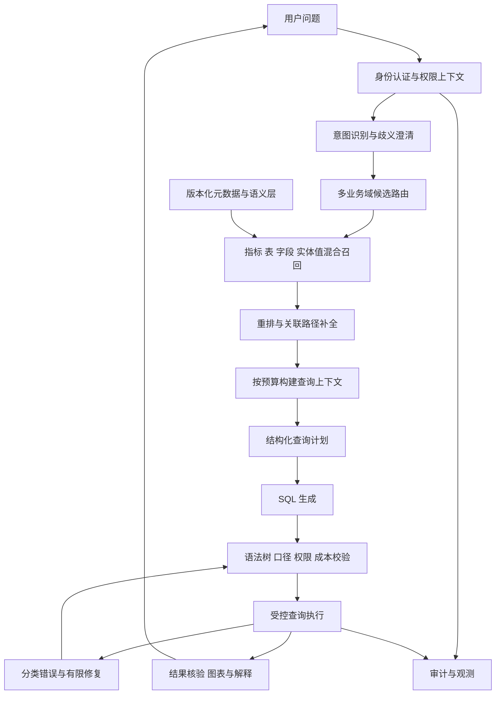

# 灵犀（Lingxi）企业级 500 表升级计划

- 编制日期：2026-10-16
- 版本：v1.0（实施草案）
- 项目目录：D:\projects\lingxi
- 目标：从 6 表演示型 Text-to-SQL，升级为可治理、可授权、可验证的 500 表智能问数平台。
- 范围说明：本文为升级设计与验收建议，不代表下述能力已经实现。数据源、实际业务表、部署资源和并发目标尚待确认。

## 1. 总体判断

采用“元数据与语义层治理 + 检索式 Schema 供给 + 受控 SQL 执行”的路线。500 是平台可管理的表数量，不是每个问题都要访问的表数量，也不等于生产可用性证明。

实施顺序：先修复评测基线，同时建立权限与语义模型；尽早验证检索；再逐级扩展到 500 表。多候选生成、复杂任务分解和微调由实验收益决定。

## 2. 现状与缺口

| 模块 | 当前实现 | 升级缺口 |
| --- | --- | --- |
| 数据模型 | src/schema.py 定义 6 张表 | 自动采集、业务补充、版本管理、动态授权 |
| Schema 供给 | prompts.py 注入全量表字段及固定示例 | 按问题、权限、预算检索上下文 |
| 语义口径 | Prompt 与示例承载部分约定 | 独立的指标、粒度、关联和实体值模型 |
| SQL 生成 | 单轮生成，执行失败修复一次 | 结构化计划、歧义澄清、分类修复 |
| SQL 校验 | 自研词法分析与全局白名单 | 语法树作用域解析、用户权限、执行预算 |
| 执行 | DuckDB 只读连接、fetchall | 超时取消、资源限制、并发与结果大小控制 |
| 接口与历史 | FastAPI、SQLite 历史与收藏 | 身份认证、历史隔离、审计、错误分类 |
| 评测 | 18 条用例与干扰表扩展实验 | 多域真实问题、权限、检索、性能分层评测 |

关键问题：README 声称 18 条结果准确率 100%，而 table_scaling_experiment.md 在 6 表时记录 33.3%。必须核对报告对应的代码、数据、模型配置、生成 SQL 和结果比较逻辑，不能预先认定原因。

现有 Prompt 中“问题含糊时输出最合理查询，不要拒绝”的规则应改为：关键指标、时间或对象存在歧义时请求澄清，或展示经业务批准的默认口径。

## 3. 目标架构

每次请求绑定用户权限、元数据版本、指标版本和检索上下文。修复不得扩大权限或绕过校验；相关状态变化后应重新获取上下文。

## 4. 元数据与语义层

### 4.1 元数据目录

自动采集库、Schema、表、列、类型、注释、主键和已声明外键；业务人员补充领域、同义词、负责人、敏感等级和经过确认的逻辑关联。未声明外键和同名字段不能自动视为可关联关系。

建议逻辑实体：data_sources、business_domains、tables、columns、relationships、metrics、business_terms、entity_values、policy_bindings、schema_versions。实际物理表结构在阶段 A 设计。

元数据发布采用草稿、校验、审核、发布和回滚流程。数据库结构、检索索引和权限策略需要版本兼容检查；不一致时拒绝受影响查询或使用已验证快照。

### 4.2 语义定义

每张表记录一行代表什么、唯一键、业务时间、数据新鲜度和允许用途。每条关联记录左右键、基数、可用方向、桥接方式及重复统计风险。

每个指标记录：名称、别名、业务定义、公式、来源、粒度、默认过滤、时间字段、可用维度、单位、币种、含税规则、负责人及版本。例如销售额必须明确订单、发货或开票口径；缺陷率应明确分子分母及聚合方式。

优先使用经过验证的指标表达式和语义视图。对明细表之间的多对多关联，应先按目标粒度聚合或使用批准的桥接路径，不能直接拼接后求和。

## 5. 检索式 Schema 供给

1. 在授权范围内识别多个业务域候选，支持跨域问题和路由失败回退。
2. 分别建立表、字段、指标索引，保留父子关系；采用关键词与向量混合召回。
3. 使用实体值索引，将“华东”“压缩机”等业务表达映射到标准字段和值。敏感值须脱敏或禁止索引。
4. 对候选重排，综合业务语义、精确名称、指标依赖和关系可达性。
5. 补齐候选表之间经批准的关联路径，并保留主键、关联键、时间、过滤和指标依赖字段。
6. 按目标模型 tokenizer 与上下文预算裁剪，记录候选、得分、补全原因和最终上下文。

禁止无限扩展所有外键邻居。路径补全需要限制跳数、候选数量和预算；多条合理路径无法判断时应澄清。

10～20 张候选表仅作为调参起点，不是固定要求。简单问题应尽量收敛，复杂问题按完整性与预算调整。召回失败应区分权限不足、目录缺失和语义不明确。

## 6. 查询计划与生成

查询计划至少包含指标及版本、维度、时间范围、过滤、粒度、候选表、关联路径、排序、TopN 和待澄清项。先验证计划，再生成目标数据库方言的 SQL。

检索相似且授权的 few-shot，避免始终注入全部示例。示例 SQL 也应经过版本兼容检查。

错误修复分为语法、绑定、方言、资源和业务语义问题。初始可保留一次修复，之后通过评测决定是否增加；必须限制总次数、总耗时与调用成本。权限拒绝不允许通过改写 SQL 绕过。

Self-consistency 与多候选执行仅对经验证有收益的复杂问题启用。候选结果一致不代表业务正确，不能替代语义校验和参考答案。

生产环境缺少模型配置或调用失败时应明确返回不可用，不得静默生成模拟业务结果；mock 保留在显式演示与测试模式。

## 7. 权限、安全与执行治理

### 7.1 权限闭环

首期实现认证与用户/角色上下文。依据实际组织边界实施表、列及必要的行级权限，覆盖元数据检索、字段示例、SQL、结果、历史、收藏、导出和缓存。

数据库使用最小权限账号。支持原生 RLS 的数据源优先在数据库落实；其他数据源需通过安全视图、受控查询网关或物理隔离形成可验证的执行边界，不能仅依赖 Prompt 或字符串追加 WHERE。

PostgreSQL RLS 要验证账号不是超级用户或 BYPASSRLS 角色，并检查表所有者等绕过行为。

### 7.2 SQL 与资源控制

采用支持目标方言的 SQL 语法树解析，解析作用域、别名、CTE、子查询和真实表列依赖；无法确认安全的表达式拒绝执行。动态元数据白名单与用户授权分别校验。

限制多语句、写入、管理命令、外部文件/网络访问、不受控函数、危险笛卡尔积和不合理关联。分析计划时按引擎能力使用不实际执行查询的 EXPLAIN；成本估算仅作辅助。

执行侧设置查询截止时间、可取消机制、内存/线程/临时磁盘限制、并发队列、返回行数及字节上限。LIMIT 只限制结果数量，不保证扫描成本低。并发和总资源上限不能只依赖单连接配置。

每次修复后的 SQL 重新执行全部检查。保留请求 ID、主体、版本、计划、最终 SQL、耗时、拒绝原因和执行状态；日志避免保存敏感值。

缓存键包含权限作用域、指标与 Schema 版本、查询参数及数据新鲜度标识；权限或数据更新需失效。历史与收藏按主体隔离。

## 8. 技术选型原则

| 部分 | 初期建议 | 决策依据 |
| --- | --- | --- |
| API 与前端 | 保留 FastAPI 与现有界面 | 优先复用已完成能力 |
| 元数据与服务状态 | 评估 PostgreSQL | 多用户一致性、版本和审计需求 |
| 向量索引 | 如使用 PostgreSQL，先验证 pgvector | 用实际检索效果和延迟决定是否拆独立向量库 |
| Embedding | 评测中文与业务混合术语模型 | 同义词、缩写、字段名和值匹配表现 |
| SQL 解析 | 评估成熟 AST 工具与方言支持 | 安全与复杂 SQL 用例验证，不把解析器当唯一安全边界 |
| 数据执行 | 保留 DuckDB 作为本地验证环境，增加连接器接口 | 生产引擎按扫描量、并发、更新及延迟要求选择 |
| 缓存与队列 | 先建立接口和限制，再按负载引入组件 | 避免无需求堆叠基础设施 |

500 表本身不要求 Milvus，也不要求更换 OLAP 引擎。生产数据源选择不得只依据表数量或是否达到 TB。

## 9. 代码改造映射

以下为建议结构，按阶段实施，避免一次性重写。

| 现有位置 | 改造方向 |
| --- | --- |
| src/schema.py | 保留测试模型，生产切换到版本化 MetadataProvider |
| src/engine/prompts.py | 接受显式 QueryContext，生成与修复使用一致的授权上下文 |
| src/engine/few_shots.py | 演示样例保留，增加经过验证的示例检索 |
| src/engine/text2sql.py | 引入查询计划、澄清状态及有预算的生成/修复 |
| src/engine/sql_guard.py | 改为 AST、授权、语义关联与执行策略的组合校验 |
| src/engine/executor.py | 提取连接器，补充取消、资源和结果大小限制 |
| src/engine/engine.py | 编排身份、检索、计划、校验、执行与审计 |
| src/api/main.py | 认证依赖、用户上下文、请求 ID、结构化错误与限流 |
| src/history.py | 用户隔离、数据保留与授权检查；按多用户需要迁移存储 |
| src/eval_cases.py 与 scripts/eval.py | 分层评测、版本快照、失败归因 |
| scripts/table_scaling_experiment.py | 保留干扰实验，新增真实多域与困难关联实验 |

建议新增模块：metadata、semantic、retrieval、auth、connectors、observability。引擎返回状态应区分成功、需澄清、无权限、数据不可用和执行失败，避免所有异常仅靠一个 error 字符串表达。

## 10. 分阶段实施与退出条件

### 阶段 A：可信基线与治理基础

- 复核两份评测报告，固定代码、数据、模型配置与参考答案快照。
- 定义元数据、指标、关系、权限模型及服务接口。
- 接入身份，隔离历史与收藏；梳理敏感字段。
- 修改歧义处理与生产 mock 行为。
- 在现有 6 表上验证粒度、关联和指标定义。

交付：可信基线报告、目录/指标模型、权限矩阵、接口契约及迁移方案。
退出条件：原有测试通过；评测差异有证据解释；授权边界具备自动化验证。

### 阶段 B：50～100 表检索闭环

- 建立多个实际风格业务域，包含可查询数据与参考问题。
- 实现混合召回、重排、实体值匹配及关联补全。
- 引入 AST 校验、受控执行和追踪。
- 对比全量 Schema、关键词、向量、混合检索，记录消融结果。

交付：检索式问数闭环、至少 200 条经审核的业务问题、分层评测报告。
退出条件：检索完整性、结果正确性和安全测试达到评审通过的阶段目标。

### 阶段 C：200～500 表与生产负载验证

- 接入/构建 500 张有治理信息的表，覆盖相似表、桥接表、历史版本和跨域问题。
- 完成元数据增量更新、版本发布回滚与索引一致性检查。
- 完成权限感知缓存、并发配额、取消、审计和故障恢复。
- 执行真实模型评测、并发压测及权限回归。

交付：500 表目录、500～1000 条经审核的问题集、性能与安全报告、部署运维手册。
退出条件：在固定资源、数据规模和负载条件下通过正式验收；明确未支持的问题范围。

### 阶段 D：按证据优化

对失败集中类型引入多候选、任务分解或更强模型；业务积累充分后再评估微调。每项优化需证明收益，并记录延迟、成本和回归影响。

## 11. 评测与验收建议

下列数值是待业务和技术共同确认的初始目标，不是当前成绩或能力承诺。

| 指标 | 初始建议目标 | 统计口径 |
| --- | --- | --- |
| 目录规模 | 500 张受治理表 | 不以空表或复制表凑数；记录实际表与合成表比例 |
| 必需表完整召回率 | ≥95% | 单题所需表全部被召回才算通过，K 与预算固定 |
| 必需字段与关联路径覆盖 | ≥95% | 包括计算、过滤、时间与桥接依赖 |
| SQL 执行成功率 | ≥95% | 对支持范围内、明确且授权的问题统计 |
| 端到端结果正确率 | 总体 ≥90%，关键指标专项 ≥95% | 使用冻结盲测集，按复杂度和业务域分别报告 |
| 越权防护 | 规定测试集全部阻断 | 覆盖数据、元数据、历史、缓存与导出；通过测试不等于无漏洞证明 |
| 性能与成本 | 阶段 A 确定目标 | 明确硬件、行数、扫描量、并发、P95、超时率与每问成本 |
| 元数据变更 | 发布与回滚可验证 | 变更触发受影响问题和权限回归 |

问题集覆盖单表、多表、跨域、比率、同比环比、粒度冲突、实体歧义、无数据、无权限、无法回答、复杂 SQL 以及恶意输入。澄清与拒绝题单独计分，避免通过拒答抬高结果准确率。

拆分开发集与冻结盲测集。真实模型与 mock 分开报告；保存模型标识、采样参数、Schema/指标/数据版本、检索结果、SQL、参考结果和逐题错误分类。结果比较区分无序集合、排序结果、重复行、NULL、日期与数值精度。

500 表验证同时开展：①固定原问题逐步添加干扰表；②新增业务域与跨域真实问题。前者验证抗干扰，后者验证业务覆盖，两者不能互相替代。

## 12. 首批任务与待确认事项

首批任务依赖顺序：评测差异定位 → 元数据/指标/权限模型 → 检索上下文契约 → 50 表最小闭环 → 安全与结果回归 → 扩到 100/200/500 表。

实施前确认：

1. 500 表来自真实业务，还是合成演示；是否已有数据字典与指标负责人。
2. 首批支持的业务域、问题边界和关键指标。
3. 数据库种类、方言、数据量、更新频率和新鲜度要求。
4. 用户角色、部门/租户隔离、敏感字段及结果导出要求。
5. 部署环境、模型可用性、目标并发、响应时间与预算。

上述信息确定后再估算工期，避免按表数量直接承诺交付日期。

## 13. 参考资料与论据边界

- BIRD 原论文：https://arxiv.org/abs/2305.03111 。包含 95 个数据库和 12,751 个问题，不可直接推导“单库 100 表准确率必然为 50%～60%”。
- DuckDB 安全说明：https://duckdb.org/docs/current/operations_manual/securing_duckdb/overview 。只读连接之外仍需约束外部访问和资源使用。
- PostgreSQL RLS：https://www.postgresql.org/docs/current/ddl-rowsecurity.html 。部署时检查超级用户、BYPASSRLS、表所有者等权限行为。

Token 预算使用目标 tokenizer 测量；“500 表 × 10 字段 × 每字段 30～50 token”只得到字段部分约 15万～25万 token 的粗估，不能作为固定容量结论。
